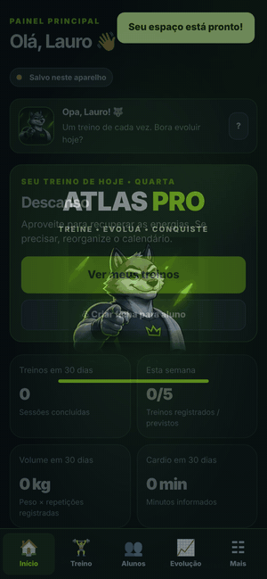
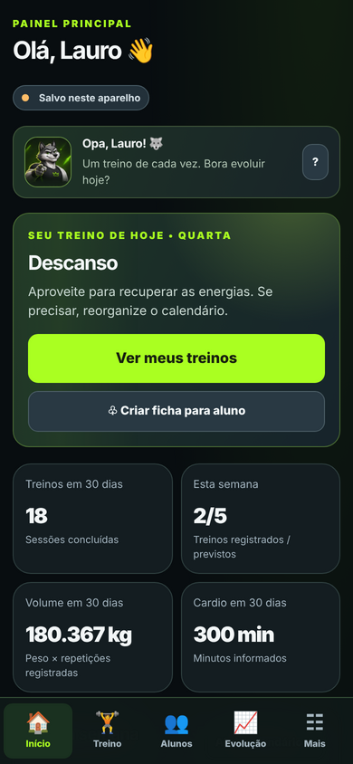
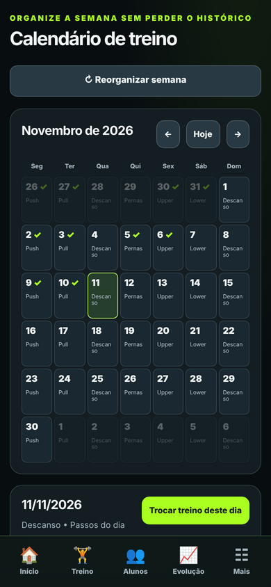
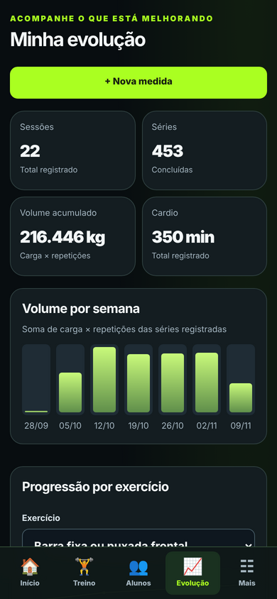
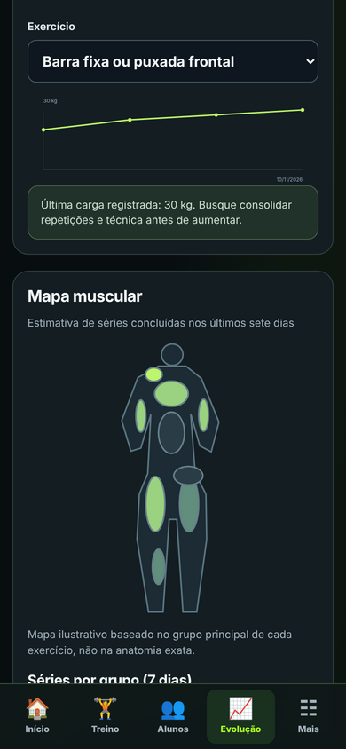
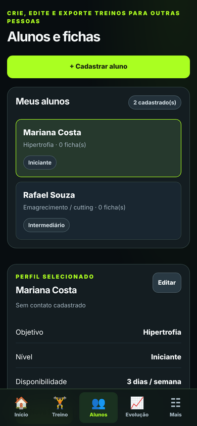

# ATLAS Training Pro

Aplicativo web (PWA) para registrar treinos, acompanhar a evolução física e gerenciar alunos. Funciona no celular como um app instalado e guarda os dados no próprio aparelho, com backup opcional na nuvem.

**[Abrir o app](https://lauropimentel24-gb.github.io/atlas-training-pro/)**

<p align="center">
  
</p>

## Telas

| Início | Calendário | Evolução | Mapa muscular | Alunos |
|:---:|:---:|:---:|:---:|:---:|
|  |  |  |  |  |

*Imagens com dados de exemplo.*

## Funcionalidades

- **Treinos:** monte cada dia da semana, use modelos prontos e registre a sessão exercício por exercício.
- **Calendário:** organização semanal e histórico dos últimos treinos.
- **Progresso:** progressão por exercício, volume semanal por grupo muscular, mapa muscular e medidas corporais.
- **Recuperação:** sugestões com base no histórico de treinos.
- **Alunos:** cadastro de alunos, com ficha de treino exportada em PDF.
- **Backup:** exportação manual em JSON e sincronização opcional com o Supabase, protegida por e-mail.
- **Offline:** service worker com cache, o app abre mesmo sem internet.

## Tecnologias

HTML, CSS e JavaScript puros, num único arquivo, sem framework e sem etapa de build. PWA com `manifest.webmanifest` e `service-worker.js`. Backup na nuvem com [Supabase](https://supabase.com), com Row Level Security: cada usuário só lê e grava o próprio backup.

## Como usar

1. Abra o link acima no navegador do celular.
2. **iPhone:** no Safari, toque em Compartilhar e depois em *Adicionar à Tela de Início*. **Android:** no Chrome, toque no menu e depois em *Instalar app*.
3. Informe seu nome e comece a registrar.

O passo a passo completo, com a configuração da nuvem, está em [`GUIA_IPHONE_E_NUVEM.html`](GUIA_IPHONE_E_NUVEM.html).

### Backup na nuvem (opcional)

1. Crie um projeto gratuito no Supabase.
2. Rode o script [`SUPABASE_BACKUP_SEGURO.sql`](SUPABASE_BACKUP_SEGURO.sql) no SQL Editor.
3. No app, em *Ajustes*, informe a URL do projeto e a chave **anon** (pública).

Nunca use a chave `service_role` no app nem a coloque no repositório.

## Rodar localmente

```bash
git clone https://github.com/lauropimentel24-gb/atlas-training-pro.git
cd atlas-training-pro
python -m http.server 8000
```

Depois abra `http://localhost:8000`. O service worker só funciona via `http://localhost` ou HTTPS, não abrindo o arquivo direto.

## Limitações

- O acesso pelo nome é local e não é uma autenticação. Quem pegar o aparelho desbloqueado vê os dados.
- Os dados ficam no navegador. Limpar os dados do site apaga tudo, então faça backup.

## Autor

Desenvolvido por [Lauro Pimentel](https://github.com/lauropimentel24-gb).
